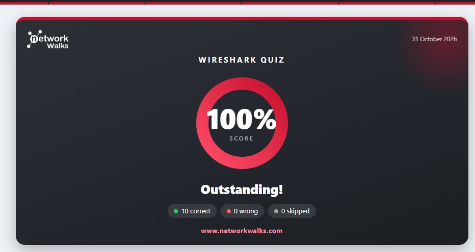
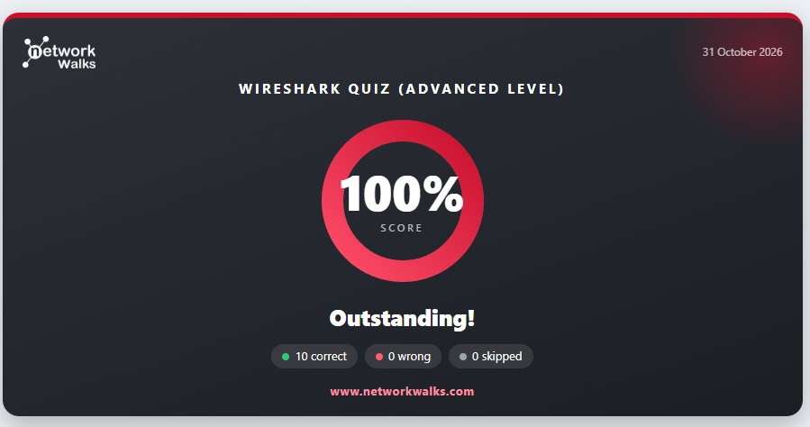

# 🛡️ SOC Wireshark Extra Project - Week 1 (NetworkWalks)

<p align="center">
  
  
  
  
  
</p>

---

## 📌 1. Project Profile & Executive Summary

### 👤 Project Information
| Attribute | Specification Details |
| :--- | :--- |
| **Full Name** | **Angga Yoga Syahputra** |
| **Participant ID / Batch** | **B084** |
| **Academic Affiliation** | **Department of Information Technology, Faculty of Vocational Studies, Universitas Brawijaya** |
| **Program** | **Cybersecurity Internship Program — NetworkWalks Academy** |
| **Project Module** | **SOC Wireshark Extra Project - Week 1** |
| **Completion Date** | **October 31, 2026** |
| **Remote Repository** | [GitHub Repository](https://github.com/anggaaygaa/Networkwalks-Angga-Yoga-Syahputra-B084-SOC-Wireshark-Extra-Project-Week-1.git) |

### 🎯 Executive Summary
This repository documents the comprehensive completion of the **SOC Wireshark Extra Project - Week 1**, hosted by **NetworkWalks Academy**. The project is designed to simulate the core daily responsibilities of a **Tier 1 / Tier 2 Security Operations Center (SOC) Analyst** and **Network Forensics Investigator** through hands-on packet inspection of raw packet capture files (`.pcapng`).

The primary investigation domains include:
1. **Network Anomaly & Port Scanning Detection**: Isolating hostile reconnaissance patterns and mapping attacker vectors.
2. **TCP Stream Reconstruction**: Reassembling unencrypted conversational streams to extract operational and sensitive data.
3. **Payload Inspection & Data Extraction**: Tracking exfiltrated internal files, hidden tokens, and clear-text authentication credentials.
4. **Brute-Force Attack Identification**: Correlating rapid authentication bursts to distinguish repeated failed attempts from successful compromise.
5. **VoIP Telephony Forensics & Audio Replay**: Decoupling call signaling (SIP) from media streams (RTP) and reconstructing recorded audio to expose social engineering/vishing fraud.
6. **Advanced PCAP Packet Diagnostics**: Analyzing IP Time to Live (TTL) hop distances, protocol distributions, top talkers by byte volume, and TCP retransmissions indicative of network congestion or packet drops.

---

## 🏆 2. Summary of Achievements

All interactive laboratory modules and evaluation quizzes were accomplished with perfect scores (**100% / Grade A**):

| No | Module / Lab Name | Focus Area & Key Artifacts | Final Score |
| :-: | :--- | :--- | :-: |
| **01** | **Wireshark SOC Lab 3 · Identify the Attacker's IP** | *Port Scanning Detection, SYN Packet Filtering (`tcp.flags.syn==1`), Reconnaissance Analysis, Open vs. Closed Port Response Evaluation (`RST, ACK`)* | **100%** (100/100 marks) |
| **02** | **Wireshark SOC Lab 4 · Follow TCP Stream** | *Internal Chat Session Reassembly, TCP Stream Reconstruction, IT Helpdesk Credential & Wi-Fi Extraction, Stream Direction & Syntax Coloring Analysis* | **100%** (100/100 marks) |
| **03** | **Wireshark SOC Lab 5 · Follow TCP Stream, part 2** | *Advanced Multi-Stream Payload Analysis, Hidden Data & Secret Code Word Discovery, Backup Server Identification, File Exfiltration Tracking* | **100%** (100/100 marks) |
| **04** | **Wireshark SOC Lab 6 · HTTP plain text credentials** | *Clear-text Protocol Vulnerability Assessment, HTTP POST Request Inspection, Form Data Parameter Extraction (`username` & `password`), TLS/HTTPS Hardening* | **100%** (100/100 marks) |
| **05** | **Wireshark SOC Lab 7 · Brute force catch** | *Authentication Brute Force Investigation, Failed vs. Successful Login Correlation, Anomaly Frequency Analysis, Credential Compromise Identification* | **100%** (100/100 marks) |
| **06** | **Wireshark SOC Lab 8 · VoIP call replay** | *VoIP Protocol Decoupling (SIP Signalling vs. RTP Media Stream), Audio Codec Forensics, Call Player Replay, Financial Fraud / Scammer Intelligence Extraction* | **100%** (100/100 marks) |
| **07** | **Wireshark Quiz (Basic Level)** | *Wireshark UI Layout Mastery (Three-Pane Architecture), OSI/TCP-IP Stack Inspection, Fundamental Protocol Analysis (ARP, ICMP, DNS, TCP, HTTP), Display Filters* | **100%** (10/10 Correct) |
| **08** | **Wireshark Quiz (Advanced Level)** | *Advanced PCAP Forensic Evaluation (TTL Hop Analysis, Obfuscated Token Hunting, Protocol Hierarchy & Conversation Statistics, TCP Retransmission Diagnostics, Plain-text Credential Extraction)* | **100%** (10/10 Correct) |

---

## 🔍 3. Technical Walkthrough & Forensic Breakdown

### 🔬 3.1 Wireshark SOC Labs (Lab 3 – Lab 8)

```
+----------------------------------------------------------------------------------------------------+
|                                    SOC INCIDENT TRIAGE WORKFLOW                                    |
+----------------------------------------------------------------------------------------------------+
|  [Reconnaissance]       [Stream Follow]       [Cleartext Hunt]     [Brute-Force]     [VoIP Replay] |
|   Lab 3: Port Scan  ->   Lab 4 & 5: TCP   ->   Lab 6: HTTP POST  -> Lab 7: Auth   ->  Lab 8: RTP   |
|   SYN Flag Anomaly       Chat & Hidden Data    Plain Credentials    Spray Analysis    Audio Fraud  |
+----------------------------------------------------------------------------------------------------+
```

#### 🛡️ Lab 3 – Identify the Attacker's IP
- **Investigation Scenario**: Suspicious port scanning activity was detected against internal network infrastructure. The SOC analyst's task was to pinpoint the attacker's IP, identify the targeted host, and map all accessible open ports.
- **Tactics & Display Filter**:
  - Isolated initial TCP connection handshakes using a dedicated SYN filter:
    ```wireshark
    tcp.flags.syn == 1 && tcp.flags.ack == 0
    ```
    *(or by engaging the built-in simulator button: `Show only SYN packets`)*.
- **Key Forensic Findings**:
  - **Attacker IP**: Discovered the adversarial source host transmitting rapid bursts of SYN packets with microsecond inter-packet intervals.
  - **Target IP**: Identified the internal production server subjected to unauthorized reconnaissance.
  - **Source Port & Probed Ports**: The attacker cycled through randomized ephemeral source ports while probing a targeted sequence of destination ports.
  - **Open Ports**: Services that responded with a `[SYN, ACK]` handshake packet, confirming active daemons (e.g., standard HTTP, FTP, and SSH services).
  - **Closed Ports**: Inactive/blocked ports that replied with a `[RST, ACK]` (*Connection Reset*) control packet.
  - **Attack Classification**: *TCP SYN Stealth Port Scanning (Half-Open Scan)*.
- **Remediation & Defensive Controls**: Enforce stateful firewall filtering, apply SYN flood/probe rate-limiting at boundary routers, implement Suricata/Snort intrusion detection rules for SYN scanning anomalies, and disable non-essential public-facing ports.

---

#### 💬 Lab 4 – Follow TCP Stream
- **Investigation Scenario**: Reconstructing an unencrypted internal chat dialogue between an enterprise employee and the IT Helpdesk over the corporate LAN.
- **Tactics & Display Filter**:
  - Executed the **Follow > TCP Stream** feature on the initial packet of the conversation:
    ```wireshark
    tcp.stream eq 0
    ```
- **Key Forensic Findings**:
  - **Chat Port**: Identified the dedicated internal messaging application port utilized by both endpoints.
  - **Communication Initiator**: Determined the originating workstation user who dispatched the initial greeting and initiated the TCP session.
  - **Stream Index & Payload Volume**: The exchange was indexed under Stream `0` spanning several kilobytes of ASCII conversational text.
  - **Extracted Artifacts & Disclosed Credentials**:
    - The client requested urgent troubleshooting assistance regarding a locked/inaccessible network storage volume (*problem drive*).
    - Highly confidential credentials were transmitted in clear text across the wire: **Temporary Account Password** and **Guest Wi-Fi Network Password**.
  - **Wireshark Stream Text Coloring Rules**: Data highlighted in **Red** represents transmissions originating from the client/initiator (*Client Request*), whereas data highlighted in **Blue** represents responses returned by the recipient/server (*Server Response*).
- **Remediation & Defensive Controls**: Mandate end-to-end encrypted enterprise messaging suites (e.g., Signal or TLS-enforced Slack/Teams), institute Data Loss Prevention (DLP) controls to flag clear-text passwords in transit, and enforce automated time-based password expiration upon Helpdesk distribution.

---

#### 🕵️ Lab 5 – Follow TCP Stream, part 2
- **Investigation Scenario**: Advanced multi-stream packet forensics to track employee web navigation, locate secondary internal servers, and uncover covertly transmitted data.
- **Tactics & Display Filter**:
  - Iterated across successive TCP streams to dissect application layer payloads:
    ```wireshark
    tcp.stream eq 1  # or tcp.stream eq 2
    ```
- **Key Forensic Findings**:
  - **Accessed Web Resources**: Traced HTTP GET queries requesting restricted corporate intranet documentation.
  - **Hidden Data Location (*Where is it hidden*)**: Discovered confidential intelligence concealed directly inside the body payload of an internal document transfer.
  - **Stream Number**: Isolated to a specific TCP stream number responsible for the file transfer session.
  - **Secret Code Word**: Successfully extracted a designated secret authorization token (*code word*) embedded within the payload.
  - **Backup Server & Flow Direction**: Determined the IPv4 address of the secondary disaster-recovery server along with the bidirectional flow direction (*inbound vs. outbound*).
  - **HTTP Status Code**: Verified a `HTTP/1.1 200 OK` server response header, confirming that file exfiltration completed unimpeded.
  - **File Name & Report Author**: Extracted the exact file name of the downloaded report archive along with the metadata name of the report author.
- **Remediation & Defensive Controls**: Harden web server directory indexing, mandate TLS-encrypted communication for internal intranet repositories, isolate backup infrastructure behind strict zero-trust network policies, and deploy Deep Packet Inspection (DPI) egress filters.

---

#### 🔓 Lab 6 – HTTP Plain Text Credentials
- **Investigation Scenario**: Security assessment of an obsolete clear-text web authentication portal (HTTP port 80) susceptible to sniffing and Man-in-the-Middle (MITM) attacks.
- **Tactics & Display Filter**:
  - Filtered authentication form submissions across the network:
    ```wireshark
    http.request.method == "POST"
    ```
- **Key Forensic Findings**:
  - **HTTP Method & Target URI**: Form submission executed via the `POST` method targeting the login authentication endpoint (e.g., `/login.php`).
  - **Client Workstation IP**: Pinpointed the source workstation IP address performing the sign-in procedure.
  - **Attempt Frequency**: Audited the exact number of login attempts submitted by the client workstation.
  - **Extracted Credentials**: Inside the *Packet Details* pane under the `Hypertext Transfer Protocol` layer -> `HTML Form URL Encoded` section, both the **username** and **password** were exposed in plain text.
  - **Root Cause**: Transmission of authentication parameters across an unencrypted Layer 7 transport mechanism lacking cryptographic encapsulation.
- **Remediation & Defensive Controls (*The Fix*)**:
  - Enforce mandatory **HTTPS (TLS 1.3)** across all authentication and web endpoints.
  - Configure HTTP Strict Transport Security (HSTS) with the `preload` directive to mitigate SSL Stripping attacks.
  - Apply `Secure` and `HttpOnly` flags to session cookies and enforce Multi-Factor Authentication (MFA).

---

#### 🔨 Lab 7 – Brute Force Catch
- **Investigation Scenario**: Real-time SOC investigation of an automated credential guessing attack (*dictionary/brute-force*) targeting an enterprise authentication service.
- **Tactics & Display Filter**:
  - Filtered consecutive authentication requests and correlated HTTP status response codes:
    ```wireshark
    http.request.method == "POST" || http.response.code == 401 || http.response.code == 200
    ```
- **Key Forensic Findings**:
  - **Target Protocol & Service**: The web login portal was targeted over standard HTTP POST requests.
  - **Attacker IP vs. Target IP**: Identified an external attacker IP generating hundreds of unauthorized requests against the production host within seconds.
  - **Targeted Username**: The attacker specifically targeted a high-privilege account (e.g., `admin`).
  - **Failure Response Code & Volume**: The server persistently issued `401 Unauthorized` responses alongside login failure payloads for each incorrect guess.
  - **Success Response Code**: Following prolonged failures, a final `200 OK` (or redirection `302 Found`) response was registered, denoting authentication success.
  - **Compromised Password**: Successfully isolated the cracked password payload submitted in the final POST request that successfully breached the system.
  - **Attack Classification**: *Automated Dictionary / Password Spraying Attack*.
- **Remediation & Defensive Controls**: Implement account lockout thresholds (e.g., 5 invalid attempts lock the account for 15 minutes), deploy CAPTCHA/Cloudflare Turnstile on login endpoints, configure Fail2ban or WAF rate-limiting rules, and alert SOC SIEM on anomalous authentication volume surges.

---

#### 📞 Lab 8 – VoIP Call Replay
- **Investigation Scenario**: Network forensics investigation of captured Voice over IP (VoIP) telephony traffic to investigate a voice phishing (*vishing*) scam and recover intercepted customer financial artifacts.
- **Tactics & Display Filter**:
  - Decoupled signaling and media protocols:
    ```wireshark
    sip || rtp
    ```
  - Accessed Wireshark's built-in audio engine: **Telephony > VoIP Calls**, highlighted the active call, and engaged **Play Streams**.
- **Key Forensic Findings**:
  - **Protocol Architecture Separation**:
    - **SIP (Session Initiation Protocol)**: Handled session initialization, registration, and call teardown over UDP port 5060.
    - **RTP (Real-time Transport Protocol)**: Handled real-time digital voice media streaming.
  - **Caller Identity & Extension**: Identified the caller's display name and extension number from the SIP `From:` header.
  - **Audio Codec**: Reconstructed voice streams transmitted via standard VoIP codecs (e.g., G.711 PCMU/PCMA).
  - **Callee Identity**: Identified the internal extension and employee name who answered the incoming call (*To:* header).
  - **Audio Replay Analysis**: Auditory playback revealed an adversarial social engineering call in which the caller posed as a trusted entity to extract customer payment card information.
  - **Extracted Financial Artifacts**: Successfully extracted the victim's full **Credit Card Number** and **Expiry Date** as spoken across the call.
- **Remediation & Defensive Controls (*The Fix*)**:
  - Enforce **Secure Real-time Transport Protocol (SRTP)** for real-time voice payload encryption.
  - Deploy **SIP over TLS (SIPS)** to protect call signaling and metadata against eavesdropping.
  - Segregate all telephony traffic into an isolated, access-controlled **Voice VLAN**.
  - Conduct employee security awareness training focusing on phone vishing and payment data verification procedures.

---

### 📝 3.2 Wireshark Quiz – Basic Level (`100% Score`)
The foundational evaluation assessed comprehensive mastery of Wireshark core interface architecture and packet inspection fundamentals:
- **Wireshark Three-Pane Architecture**:
  1. **Packet List Pane**: Tabular overview of captured frames (No, Time, Source, Destination, Protocol, Length, Info).
  2. **Packet Details Pane**: Hierarchical tree deconstructing OSI / TCP-IP layer headers down to individual flag bits.
  3. **Packet Bytes Pane**: Raw hexadecimal dump and corresponding ASCII characters of the packet payload.
- **OSI / TCP-IP Protocol Stack Inspection**: Differentiating protocol characteristics across Layer 2 Data Link (Ethernet, ARP), Layer 3 Network (IPv4, IPv6, ICMP), Layer 4 Transport (TCP state machine handshakes, UDP datagrams), and Layer 7 Application (DNS queries/responses, HTTP transactions).
- **Boolean Display Filtering**: Designing robust filter expressions utilizing logical operators (`and`/`&&`, `or`/`||`, `not`/`!`), host addressing (`ip.addr == ...`, `ip.src == ...`), and specific ports (`tcp.port == 80`, `udp.port == 53`).

---

### 🎯 3.3 Wireshark Quiz – Advanced Level (`100% Score` - Question-by-Question Forensic Breakdown)
Deep-dive forensic evaluation performed on live packet capture files (`.pcapng`) during the advanced examination:

#### 🌐 Q3 (`ping_test_q3.pcapng` - How far did the reply travel?)
- **Objective**: Determine the hop distance traversed by an ICMP response packet based on the Time to Live (TTL) field.
- **Investigation**: Inspected an ICMP *Echo (ping) reply* packet transmitted from Google Public DNS (`8.8.8.8`) back to the client host `192.168.0.10` located at Frame 6.
- **Verified Finding**: The IPv4 header indicates a **`Time to Live (TTL) = 117`**. Factoring in standard upstream operating system baseline TTLs (128), this proves the reply packet traversed exactly 11 intermediate routing hops across the WAN.

#### 🔑 Q4 (`portal_q4.pcapng` - The hidden code)
- **Objective**: Discover an obfuscated secret access token stored within web server archives.
- **Investigation**: Applied display filter `http.request.uri contains "readme.txt"` to separate `/backup/readme.txt` (Frame 36) from `/backup/old-readme.txt` (Frame 26).
- **Verified Finding**: Conducted a *Follow TCP Stream* on stream 3 (`tcp.stream eq 3`) targeting `portal.company.local` (`192.168.10.80`), successfully recovering the valid secret access credential: **`TIGER-4471`**.

#### 📊 Q5 (`office_q5.pcapng` - The office mix)
- **Objective**: Quantify the protocol distribution and transport layer composition of office LAN traffic.
- **Investigation**: Evaluated network bandwidth telemetry via **Statistics > Protocol Hierarchy** across the 50 captured frames.
- **Verified Finding**: The **TCP** transport protocol constitutes exactly **`48.0%`** (24 packets) of total captured traffic, with remaining portions allocated across UDP, ICMP, and broadcast frames.

#### 💾 Q6 (`transfers_q6.pcapng` - Who moved the most data?)
- **Objective**: Identify the primary bandwidth consumers (*top talkers*) responsible for peak data volume exchange.
- **Investigation**: Accessed **Statistics > Conversations**, inspected the **IPv4** tab, and sorted the table by the *Bytes* column.
- **Verified Finding**: The host conversational pair **`172.16.5.10` and `172.16.5.50`** transferred the largest cumulative volume of data, totaling **`37 kB`** across 43 exchanged packets.

#### ⏱️ Q7 (`slow_download_q7.pcapng` - A flaky download)
- **Objective**: Diagnose network throughput degradation and stalling during the download of `/report.pdf` from file server `10.1.1.100`.
- **Investigation**: Deployed Wireshark's TCP sequence analysis display filter:
  ```wireshark
  tcp.analysis.retransmission
  ```
- **Verified Finding**: Isolated exactly **`4` TCP Retransmission packets** (recorded at Frame 15, Frame 19, Frame 20, and Frame 23), proving localized packet loss and subsequent TCP sliding window recovery delays.

#### 🔴 Q8 (`colours_q8.pcapng` - Reading the colours)
- **Objective**: Identify a connection refusal condition via Wireshark default packet coloring rules.
- **Investigation**: Scanned for packets styled with a dark red background denoting a TCP Reset condition.
- **Verified Finding**: Identified a rejected connection packet exhibiting the `[RST, ACK]` flags at **Frame 16**, dispatched from server `10.5.5.50:8081` to client `10.5.5.10:50302`.

#### 📁 Q9 (`ftp_login_q9.pcapng` - Passwords in the clear - FTP)
- **Objective**: Intercept unencrypted administrative FTP credentials destined for internal file server `192.168.20.30` (`vsFTPd 3.0.3`).
- **Investigation**: Filtered for FTP authentication strings via `ftp.request.arg contains "netadmin"` (Frame 20) and executed *Follow TCP Stream* (`tcp.stream eq 1`).
- **Verified Finding**: Extracted plain-text credentials directly from the stream payload:
  - **Username**: `USER netadmin`
  - **Password**: `PASS Backup2026`

#### 🌐 Q10 (`intranet_login_q10.pcapng` - Passwords in the clear - Web Login)
- **Objective**: Audit intranet portal authentication attempts originating from client `192.168.30.25` to web host `192.168.30.100`.
- **Investigation**: Filtered form submissions with `http.request.method == "POST"` to analyze authentication sequences.
- **Verified Finding**:
  - Frame 10: `admin / admin123` (Authentication Rejected)
  - Frame 14: `sara.khan / Winter2025` (Authentication Rejected)
  - Frame 18: `sara.khan / Winter2026` (Authentication Accepted)
  - The server's subsequent HTTP response at Frame 19 returned an HTML payload greeting `"Welcome back"`, verifying that the legitimate authorized credential set was **`sara.khan`** with password **`Winter2026`**.

---

## 📸 4. Proof of Completion (Documentation Gallery)

The following screenshots provide official visual verification of all completed lab modules and assessment quizzes with perfect scores (**100%**):

### 1. Wireshark SOC Labs (Lab 3 – Lab 8)

#### 🔹 Lab 3: Identify the Attacker's IP (Score: 100% | 100/100 marks)
<p align="center">
  
</p>

---

#### 🔹 Lab 4: Follow TCP Stream (Score: 100% | 100/100 marks)
<p align="center">
  
</p>

---

#### 🔹 Lab 5: Follow TCP Stream, part 2 (Score: 100% | 100/100 marks)
<p align="center">
  
</p>

---

#### 🔹 Lab 6: HTTP plain text credentials (Score: 100% | 100/100 marks)
<p align="center">
  
</p>

---

#### 🔹 Lab 7: Brute force catch (Score: 100% | 100/100 marks)
<p align="center">
  
</p>

---

#### 🔹 Lab 8: VoIP call replay (Score: 100% | 100/100 marks)
<p align="center">
  
</p>

---

### 2. Wireshark Quiz (Basic Level)

#### 🔹 Wireshark Quiz - Basic Level (Score: 100% | 10 Correct, 0 Wrong, 0 Skipped)
<p align="center">
  
</p>

---

### 3. Wireshark Quiz (Advanced Level)

#### 🔹 Wireshark Quiz - Advanced Level (Score: 100% | 10 Correct, 0 Wrong, 0 Skipped)
<p align="center">
  
</p>

---

## 🛡️ 5. DevSecOps & Security Hardening Recommendations

Synthesizing the forensic findings across these modules, the following defense-in-depth architectural controls are recommended:

```
+----------------------------------------------------------------------------------------------------+
|                               DEFENSE-IN-DEPTH REMEDIATION MATRIX                                  |
+----------------------+------------------------------------+----------------------------------------+
| Threat Category      | Root Cause                         | DevSecOps / SOC Defense Control        |
+----------------------+------------------------------------+----------------------------------------+
| Clear-text Sniffing  | Unencrypted protocols (HTTP/FTP)   | Mandate TLS 1.3, HSTS Preload, SFTP    |
| Port Scanning        | Exposed services, no rate limits   | Stateful ACLs, Port Knocking, Suricata |
| Brute Force Attacks  | Unlimited login attempts           | Fail2ban, WAF Rate Limit, Mandatory MFA|
| VoIP Eavesdropping   | Unencrypted SIP & RTP streams      | Enforce SIPS (TLS) & SRTP, Voice VLAN  |
| Network Stalling     | Packet loss, MTU mismatch          | TCP Window Auto-tuning, QoS Policies   |
+----------------------+------------------------------------+----------------------------------------+
```

1. **Enforce Universal Transport Cryptography**: Eliminate all unencrypted legacy protocols across production environments. Standardize on HTTPS (TLS 1.3), SFTP/SCP for file transfers, and SIPS/SRTP for real-time voice communications.
2. **Zero-Trust Network Segmentation**: Isolate production databases, internal management subnets, and VoIP communications into dedicated VLANs protected by strict stateful firewalls and access control lists (ACLs).
3. **Automated SOC Detection Rules**: Deploy threshold-based anomaly detection on SIEM/EDR systems to flag rapid bursts of TCP SYN requests and consecutive HTTP 401 response codes within short rolling time windows.
4. **Credential Security & Identity Governance**: Prohibit plain-text credential sharing across messaging channels, mandate enterprise password managers, and implement phishing-resistant Multi-Factor Authentication (FIDO2 / WebAuthn).

---

## 📜 6. References & Acknowledgments
- **NetworkWalks Academy**: *Cybersecurity Internship Program - Week 1 SOC Module*.
- **Wireshark Foundation**: *Official Wireshark User's Guide & Display Filter Reference Manual*.
- **IETF RFC Specifications**:
  - RFC 793 (Transmission Control Protocol)
  - RFC 3261 (SIP: Session Initiation Protocol)
  - RFC 3550 (RTP: A Transport Protocol for Real-Time Applications)
  - RFC 7230-7235 (Hypertext Transfer Protocol)

---
<p align="center">
  <b>Authored by Angga Yoga Syahputra (B084)</b><br>
  <i>Information Technology Student · Universitas Brawijaya</i><br>
  <i>Cybersecurity Analyst & DevSecOps Enthusiast</i>
</p>
